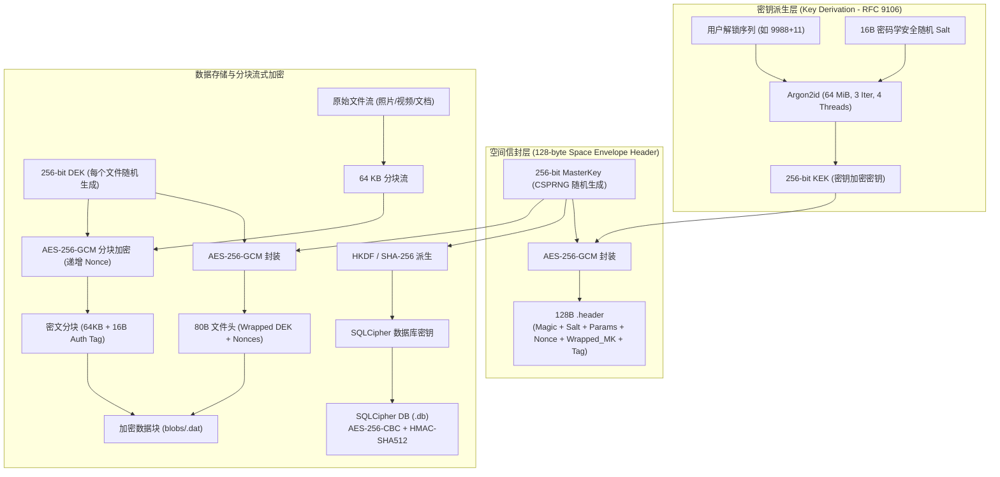

# Xome // Sovereign Cryptographic Private Vault

[](https://www.gnu.org/licenses/agpl-3.0)
[-green.svg)](https://developer.android.com)
[](https://kotlinlang.org)
[](https://developer.android.com/jetpack/compose)
[](https://tools.ietf.org/html/rfc9106)

**Xome** 是一款以 **端侧隐私**与 **合理怀疑抗辩**为核心设计的 Android 高强度多空间加密保险库应用。

应用外部完全伪装为一个全功能的科学计算器（FX-991EX 风格），底层深度集成了 **Argon2id (RFC 9106)** 内存困难型密钥派生、**多级信封加密体系（Envelope Encryption）**、**64 KB 分块流式 AES-256-GCM**、**SQLCipher 全库加密** 以及 **纯内存流式渲染引擎**，为敏感文件、图片、视频与私密笔记提供安全防护与抗取证保障。

---

## 目录 (Table of Contents)

- [核心特性 (Key Features)](#核心特性-key-features)
- [密码学设计与信封架构 (Cryptographic Architecture)](#密码学设计与信封架构-cryptographic-architecture)
- [文件存储与规格定义 (Storage Layout & Binary Specs)](#文件存储与规格定义-storage-layout--binary-specs)
- [安全边界与威胁模型 (Threat Model & Security Boundary)](#安全边界与威胁模型-threat-model--security-boundary)
- [原件删除与数据安全保障 (Source Deletion & Zero-Data-Loss)](#原件删除与数据安全保障-source-deletion--zero-data-loss)
- [本地开发与编译构建 (Build & Development)](#本地开发与编译构建-build--development)
- [代码规范与贡献指南 (Contributing)](#代码规范与贡献指南-contributing)
- [开源协议 (License)](#开源协议-license)

---

## 核心特性 (Key Features)

### 1. 深度伪装与盲验静默解锁 (Disguised Calculator & Blind Unlock)
* **真实科学计算器功能**：完整实现浮点算术、三角函数（`sin`/`cos`/`tan`，支持 DEG/RAD 切换）、自然对数与对数（`ln`/`log`）、幂次与阶乘（`x^y`/`x!`）、数学常数（$\pi$、$e$）以及计算历史记录管理。
* **无提示静默盲验**：界面无任何密码框、无“输入密码”提示、无生物识别指纹触发痕迹。用户在键盘输入包含数学符号的凭据并按下 `=` 时，后台协程自动拦截并执行多空间信封认证。
* **合理抗辩（Plausible Deniability）**：若输入不匹配任何保险空间，系统不弹出“密码错误”或任何安全报警，而是直接将输入当作正常算式计算并显示数学结果，抵御旁观窥探与翻查。
* **防暴力破解限速**：连续 5 次尝试失败后触发 30 秒冷却，后续失败指数级递增，最高惩罚冷却 1 小时，状态持久化锁定。

### 2. 多重独立空间与诱导空间隔离 (Multi-Space & Decoy Vaults)
* **空间相互独立**：每个空间拥有完全独立的 MasterKey、加密数据库与文件目录，互不知晓彼此存在。
* **诱导/胁迫空间（Duress / Decoy Vault）**：支持设置诱导解锁序列。在面临强制检查时，输入诱导序列仅打开包含预设常规内容的次级空间，真实敏感空间在磁盘上呈现为随机数据，不可探测。
* **分步安全向导**：提供独立的“新建独立空间”与“修改解锁密码”专注向导，一次只做一个决策，内存安全隔离，关闭即销毁输入。

### 3. 零重加密极速改密 (Zero Re-encryption Sequence Rotation)
* 传统加密软件修改密码需要将全部 GB 级文件重新解密并加密，既耗时又有断电损坏风险。
* Xome 采用**信封加密架构**：每个文件由随机 DEK 加密，DEK 由空间 MasterKey 加密，而 MasterKey 由用户序列派生的 KEK 加密并存于 128 字节头部。
* 修改解锁序列时，**仅需重新派生 KEK 并原子替换 128 字节空间头**，毫秒级完成，底层海量数据文件与 SQLite 数据库无需重新加密。

### 4. 纯内存流式解密与零临时文件 (Zero-Tempfile & In-Memory Viewer)
* **杜绝磁盘明文泄露**：不在 `/cache`、`/tmp` 或外部存储生成任何明文解密临时文件。
* **流式解密通道**：基于 `RandomAccessDecryptedStream` 实现分块即时解密，大图片、长文档、媒体文件按需解密进内存，读取完毕由垃圾回收与主动填充归还。
* **内存安全生命周期**：所有敏感密钥（MasterKey、DEK、PIN 序列）严格使用 `ByteArray` / `CharArray` 承载，使用完毕后立即显式调用 `Arrays.fill(..., 0)` 抹除，防止内存 Dump 分析。

### 5. 安全防御与自愈能力 (System Hardening & Self-Healing)
* **防截屏与录屏（FLAG_SECURE）**：进入私密空间后，系统强制开启 `FLAG_SECURE`，阻断截图、ADB 录屏、多任务最近任务（Recent Tasks）缩略图快照。
* **即时生命周期死锁**：监听应用生命周期，按 Home 键切后台、息屏锁屏、唤起外部授权时，会话密钥立即在内存中清零并锁定回退至计算器界面。
* **隐写与反系统索引**：数据根目录下写入 `.nomedia`，密文文件名全数转为无扩展名 UUID `.dat`，阻止 Android MediaStore、相册、音乐播放器扫描。
* **去中心化自愈**：数据保存在离线用户文档目录，卸载重装或清除应用数据后，扫描空间头即可自动重构数据库并完整恢复空间。

### 6. 注重隐私的离线应用内更新 (Privacy-Preserving In-App Update)
* 基于 GitHub Releases 实现前台周期性检测与工具栏徽标提示。
* 下载与安装均须用户显式确认；安装包强制进行包名、versionCode 单调递增、APK 文件大小与 3072-bit RSA 签名身份比对，不收集用户信息。

---

## 密码学设计与信封架构 (Cryptographic Architecture)



---

## 文件存储与规格定义 (Storage Layout & Binary Specs)

### 1. 物理目录结构
```text
/sdcard/Documents/.sys_vault_data/
├── .nomedia                     # 空文件，阻断系统 MediaStore 与图片扫描器
├── spaces/
│   ├── c5b98b12.header          # 主空间信封头 (固定 128 字节)
│   └── 9f2a41d0.header          # 独立诱导空间信封头 (固定 128 字节)
├── db/
│   ├── c5b98b12.db              # 主空间 SQLCipher 加密数据库 (AES-256-CBC)
│   └── 9f2a41d0.db              # 诱导空间 SQLCipher 加密数据库
└── blobs/
    ├── a1b2c3d4e5f6...dat       # 加密数据文件 (80B 头部 + 64KB AES-GCM 分块)
    └── 887766554433...dat       # 加密数据文件
```

### 2. 空间信封头二进制规范 (128-byte `.header`)
| 偏移量 (Offset) | 长度 (Bytes) | 字段名称 | 描述 |
| :--- | :--- | :--- | :--- |
| `0x00 ~ 0x07` | 8 | `HEADER_MAGIC` | 固定魔数 ASCII `"CLCVLT01"` |
| `0x08 ~ 0x17` | 16 | `Salt` | CSPRNG 生成的 16 字节 Argon2id 盐值 |
| `0x18 ~ 0x1B` | 4 | `MemoryCost` | Argon2id 内存开销（UInt32 LE，标准 65536 KB） |
| `0x1C ~ 0x1F` | 4 | `TimeCost` | Argon2id 迭代轮数（UInt32 LE，标准 3） |
| `0x20 ~ 0x23` | 4 | `Parallelism` | Argon2id 并行度（UInt32 LE，标准 4） |
| `0x24 ~ 0x2F` | 12 | `MK_Nonce` | MasterKey AES-GCM 加密随机数 (IV) |
| `0x30 ~ 0x5F` | 48 | `Wrapped_MK` | 经 KEK 加密的 MasterKey（32B 密文 + 16B GCM Tag） |
| `0x60 ~ 0x7F` | 32 | `Reserved` | CSPRNG 填充保留字段 |

### 3. 加密数据块文件头规范 (80-byte Blob Header)
| 偏移量 (Offset) | 长度 (Bytes) | 字段名称 | 描述 |
| :--- | :--- | :--- | :--- |
| `0x00 ~ 0x03` | 4 | `FILE_MAGIC` | 固定魔数 ASCII `"VBLK"` |
| `0x04 ~ 0x07` | 4 | `ChunkSize` | 分块大小（UInt32 LE，标准 65536 字节） |
| `0x08 ~ 0x13` | 12 | `DEK_Nonce` | DEK AES-GCM 加密随机数 (IV) |
| `0x14 ~ 0x43` | 48 | `Wrapped_DEK` | 经 MK 加密的 DEK（32B 密文 + 16B GCM Tag） |
| `0x44 ~ 0x4F` | 12 | `Base_Nonce` | 分块计数派生基础 IV |

---

## 安全边界与威胁模型 (Threat Model & Security Boundary)

| 攻击场景 / 威胁模型 | Xome 防御策略与表现 |
| :--- | :--- |
| **他人借用手机或日常翻查** | 呈现为一个普通且功能完备的科学计算器；没有设置项、密码框或指纹触发，无法察觉保险库存在。 |
| **口令盲猜与暴力破解** | 连续 5 次错误后触发 30 秒惩罚冷却，随后指数级递增；抗离线破解依赖 64 MiB 内存因子的 Argon2id 算法，计算成本高。 |
| **胁迫要求解锁** | 输入预设的“诱导空间”密码，打开展示无关公共文件的安全假空间，真实敏感空间在结构与存储上完全隐匿。 |
| **设备丢失 / 闪存提取取** | 磁盘数据仅包含 `.nomedia`、`.header` 和无扩展名 `.dat` 碎片。没有正确凭据，所有文件呈现为无法认证的纯随机数据。 |
| **App 截屏 / 后台窥探** | 私密空间全生命周期启用 `FLAG_SECURE`，禁止系统截图、录屏与多任务缩略图保留；切后台即刻销毁会话。 |
| **应用被卸载或数据被清除** | 外部加密存储目录不随应用卸载丢失；重新安装 Xome 后凭借原有密码即可无损自愈恢复。 |

> [!WARNING]
> **安全边界声明**：Xome 无法防御已获取 Root 权限并植入内核键盘记录器（Kernel Keylogger）的恶意系统；亦无法防御已植入硬件级 DMA 物理内存读取探针的攻击（当私密空间处于已解锁驻留 RAM 状态时）。

---

## 原件删除与数据安全保障 (Source Deletion & Zero-Data-Loss)

当在导入文件时启用 **“删除原件”** 选项时，Xome 严格遵循**零数据丢失优先法则（At-Least-Once Persistence）**：

1. **顺序**：
   - 必须先完成：① 内存缩略图生成 -> ② 64KB AES-GCM 分块加密并完整刷入磁盘 -> ③ SQLCipher 数据库事务提交；
   - **只有前三步均成功提交后**，才尝试请求删除原件；不会先删原件再写密文。
2. **中途崩溃或断电**：
   - 若在加密或落盘过程中被系统中断或断电，原文件未受任何修改，完整保留在原处；已生成的临时未登记碎片自动废弃，不丢失数据。
3. **Android 存储沙盒限制说明**：
   - 在 Android 10/11+ 作用域存储（Scoped Storage）规范下，第三方应用无权静默删除其他应用（如微信、系统相机）保存的公有媒体；
   - 系统会要求弹出系统级确认对话框（`createDeleteRequest`）。若用户取消或系统提供方拒绝，Xome 会安全捕获该状态并保留原件，不会导致闪退或数据受损。

---

## 本地开发与编译构建 (Build & Development)

### 环境依赖
* **JDK**: OpenJDK 21 或更高
* **Android SDK**: `minSdk = 29` (Android 10), `targetSdk = 36`
* **Gradle**: 9.3.1 (已包含 `gradlew` wrapper)
* **Android Gradle Plugin (AGP)**: 9.1.0

### 构建与测试指令

```bash
# 克隆仓库
git clone https://github.com/t59688/xome.git
cd xome

# 运行全套单元测试与 Robolectric 自动化测试
./gradlew testDebugUnitTest

# 编译 Debug APK
./gradlew assembleDebug

# Windows 快捷构建与部署脚本 (支持指定模拟器或真机)
./dev.bat -List
./dev.bat -Serial emulator-5554

# 构建签名 Release APK (支持 ABI 独立拆分与通用包)
./build-release.bat apk
```

### 多架构分发与体积优化
在生产 Release 构建中，项目启用了原生库压缩与 ABI 拆包配置，四种主流 CPU 架构均生成独立轻量 APK：
* **ARM64 (arm64-v8a)**: ~4.12 MB
* **ARM32 (armeabi-v7a)**: ~3.71 MB
* **x86**: ~4.16 MB
* **x86_64**: ~4.38 MB
* **Universal (通用兼容包)**: ~11.37 MB

---

## 代码规范与贡献指南 (Contributing)

欢迎提交 Issue 与 Pull Request！为了维护与代码整洁度，请遵循以下规范：

1. **密码学与隐私第一原则**：
   - 严禁向外部引入涉及用户遥测、分析统计或未经审计的第三方广告/追踪 SDK。
   - 任何涉及密码学或安全边界的变更，必须附带完备的单元测试（覆盖无效凭据、重加密抗性、参数边界）。
2. **敏感内存管理**：
   - 任何处理密码、MasterKey、DEK 的代码路径，必须在 `finally` 块中立即使用 `Arrays.fill(..., 0)` 进行零覆写清除。
3. **测试覆盖**：
   - 提交 PR 前请务必确保 `./gradlew testDebugUnitTest` 100% 通过。

---

## 开源协议 (License)

本项目采用 **GNU Affero General Public License v3.0 (AGPL-3.0)** 许可证开源。

```text
Copyright (C) 2026 Xome Contributors

This program is free software: you can redistribute it and/or modify
it under the terms of the GNU Affero General Public License as published by
the Free Software Foundation, either version 3 of the License, or
(at your option) any later version.

This program is distributed in the hope that it will be useful,
but WITHOUT ANY WARRANTY; without even the implied warranty of
MERCHANTABILITY or FITNESS FOR A PARTICULAR PURPOSE.  See the
GNU Affero General Public License for more details.

You should have received a copy of the GNU Affero General Public License
along with this program.  If not, see <https://www.gnu.org/licenses/>.
```

有关完整的许可证文本，请参阅 [LICENSE](LICENSE) 文件。
